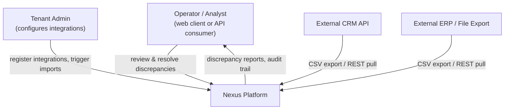
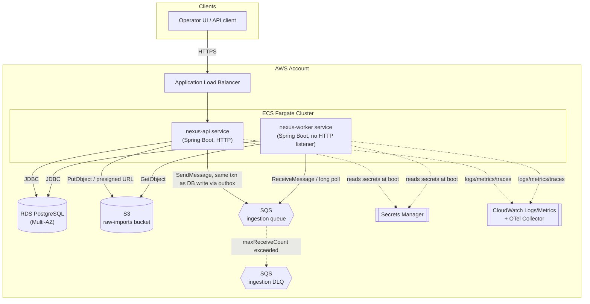
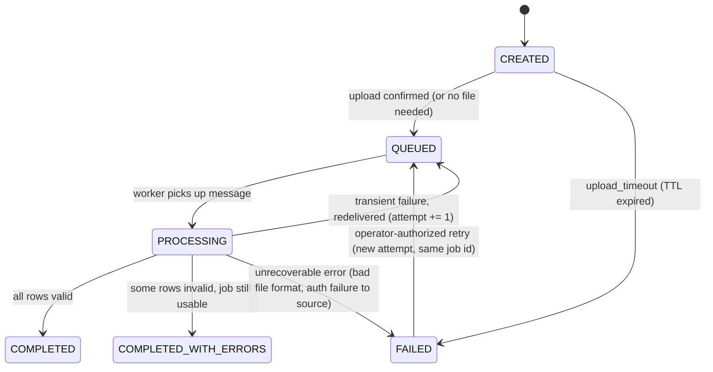
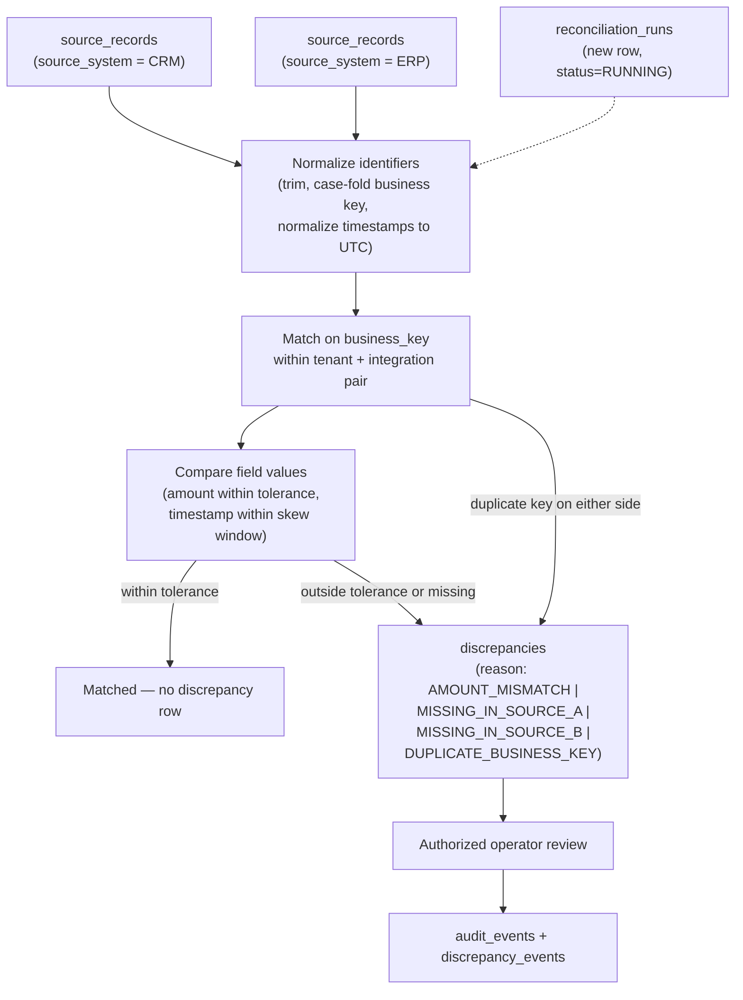
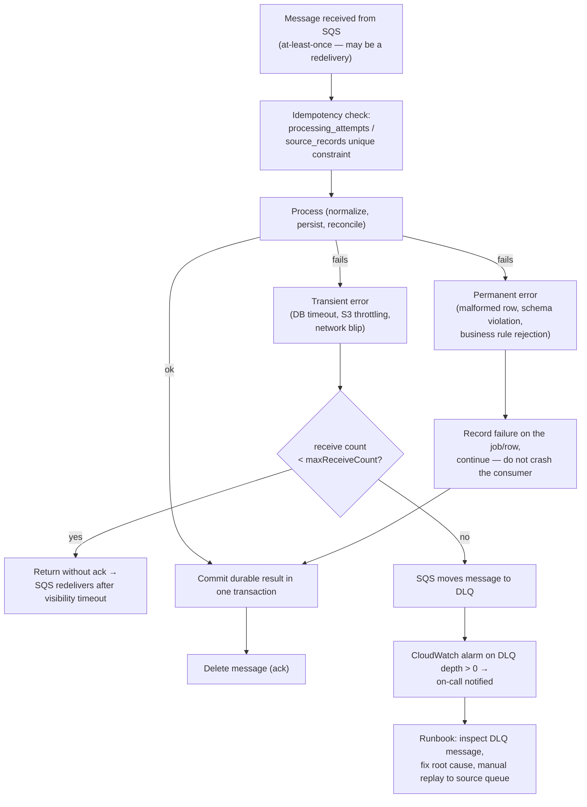
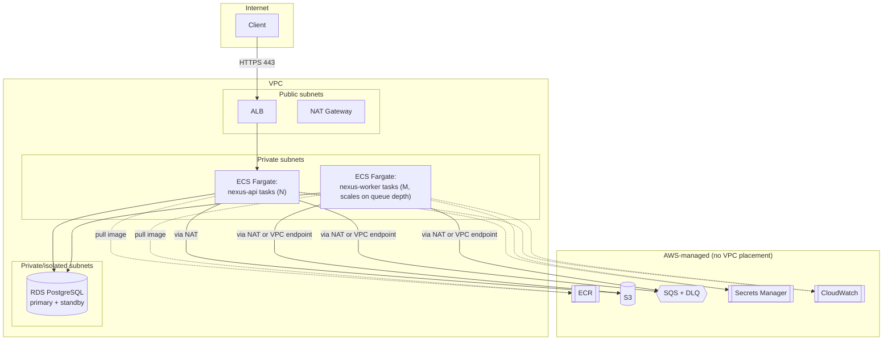
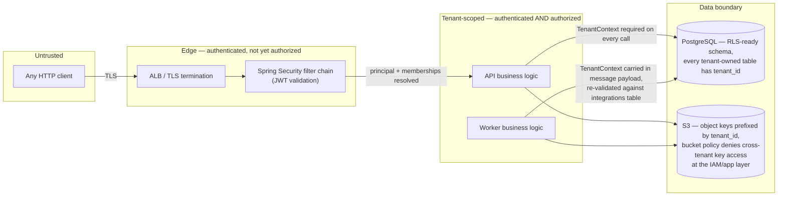

# Nexus — Architecture

Status: Phase 0 draft. No application code exists yet. This document describes
the intended architecture; it is the spec the implementation phases are
measured against, not a record of what's built.

## 1. System context

Nexus sits between operators (who configure integrations and resolve
discrepancies) and the external systems whose data is being reconciled (a CRM,
an ERP, a partner API, flat-file drops). Nexus does not write back to source
systems in v1 — it is read-only with respect to external systems and
authoritative only for its own reconciliation state.



Nexus is a system of record for **reconciliation outcomes**, not a system of
record for the underlying business data. If a discrepancy is "resolved," that
resolution lives in Nexus; it does not propagate back to the CRM or ERP in v1.

## 2. Containers



Both `nexus-api` and `nexus-worker` are built from the **same Maven artifact
and the same container image**; the entry point (Spring profile /
`spring.main.sources` toggle) determines whether the HTTP listener and
worker's SQS listener are active. This is the "modular monolith, two
deployables" shape: one codebase, one set of domain modules, two independently
scalable ECS services. There is no network call between `nexus-api` and
`nexus-worker` — they only communicate through PostgreSQL (shared state) and
SQS (work handoff). This is deliberate: it means the worker can be scaled to
zero or to N tasks based on queue depth without touching the API's scaling
policy, without introducing a second network hop that a true microservice
split would require.

## 3. Logical modules (components)

```
com.nexus
├── identity        — principal resolution, OIDC/JWT claims → internal user
├── tenant           — tenant & membership lookup, TenantContext
├── integration       — configured external systems per tenant
├── ingestion         — ingestion job lifecycle, file upload orchestration
├── normalization     — row-level validation & normalization rules
├── processing        — worker orchestration: consume → normalize → persist
├── reconciliation     — matching, comparison, discrepancy generation
├── discrepancy       — discrepancy lifecycle, resolution, review
├── audit             — append-only audit event recording & query
├── messaging         — outbox writer, outbox publisher, SQS client wrapper
├── storage           — S3 client wrapper, presigned URL issuance
├── security          — Spring Security config, tenant-scoping filters
├── observability      — Actuator customizations, Micrometer tags, OTel config
└── shared            — TenantId, Money, error codes, Result-style types
```

**Module access rule:** a module may depend on another module's published
application-service interface (e.g. `ReconciliationService`,
`AuditRecorder`) or on domain events it publishes. A module must never inject
another module's `@Repository`/`JpaRepository` directly. This is enforced by
package-level visibility (repositories are package-private where possible) and
checked by an ArchUnit test in Phase 1 (see
[build-plan.md](build-plan.md)).

## 4. Data flow — Workflow A: Import customer data

```mermaid
sequenceDiagram
    actor Operator
    participant API as nexus-api
    participant DB as PostgreSQL
    participant S3 as S3
    participant SQS as SQS (ingestion queue)
    participant Worker as nexus-worker

    Operator->>API: POST /api/v1/ingestions (Idempotency-Key, integrationId, sourceRef)
    API->>API: authenticate, resolve TenantContext
    API->>DB: check idempotency_keys for this key+scope
    alt key already used
        API-->>Operator: 200/201 with original result (no new job)
    else new key
        API->>DB: BEGIN; INSERT ingestion_jobs (status=CREATED); INSERT idempotency_keys; COMMIT
        API-->>Operator: 202 Accepted {jobId, status: CREATED}
        Operator->>API: PUT file bytes to presigned S3 URL (if file-based import)
        Note over API,S3: Upload happens outside any DB transaction —<br/>API never holds a transaction open during the S3 PUT.
        Operator->>API: POST /api/v1/ingestions/{id}/confirm-upload
        API->>S3: HeadObject (verify presence, size, checksum)
        API->>DB: BEGIN; UPDATE ingestion_jobs SET status=QUEUED; INSERT outbox_events; COMMIT
        API->>SQS: (async) Outbox Publisher reads outbox_events and sends message
        SQS->>Worker: deliver IngestionJobQueued message
        Worker->>DB: BEGIN; UPDATE ingestion_jobs SET status=PROCESSING, attempt+=1; COMMIT
        Worker->>S3: GetObject, stream rows
        loop each row
            Worker->>Worker: validate + normalize
            alt invalid row
                Worker->>DB: INSERT ingestion job error (row-level)
            else valid row
                Worker->>DB: upsert source_records (dedupe by source identity)
            end
        end
        Worker->>DB: BEGIN; UPDATE ingestion_jobs SET status=COMPLETED|COMPLETED_WITH_ERRORS, counts; INSERT audit_events; COMMIT
        Worker->>SQS: delete message (ack)
    end
```

Key design points:

- **No open transaction across the S3 PUT.** The job record is committed as
  `CREATED` before the file exists; the presigned-URL upload happens outside
  any DB transaction; `confirm-upload` is a separate request that transitions
  the job to `QUEUED` only after S3 confirms the object exists. This avoids
  holding a DB connection (and locks) for the duration of a potentially slow
  client upload.
- **Idempotency key scope is `(tenant_id, integration_id, idempotency_key)`.**
  A retried `POST /ingestions` with the same key returns the original job
  instead of creating a second one. See
  [data-model.md § idempotency_keys](data-model.md#idempotency_keys).
- **Outbox, not direct publish.** The `QUEUED` transition and the
  `outbox_events` row are written in one transaction; a separate Outbox
  Publisher process polls `outbox_events` and calls SQS. If SQS is down when
  the transaction commits, the event is still durably recorded and will be
  published on the next poll — the business state change is never lost.
- **Abandoned uploads are cleaned up**, not left as orphaned S3 objects or
  stuck `CREATED` jobs. A scheduled job (Phase 3) transitions jobs stuck in
  `CREATED` past a TTL to `FAILED` with reason `upload_timeout`, and a
  separate S3 lifecycle rule expires objects under an `incoming/` prefix that
  were never confirmed.

### Ingestion job state machine



A retry (`POST /ingestions/{id}/retry`) increments `processing_attempts` and
re-publishes an outbox event referencing the **same** `ingestion_jobs.id` — it
never creates a second `ingestion_jobs` row for the same business import. This
is what "a retry must not silently create a second business import" means in
practice.

## 5. Data flow — Workflow B: Reconcile records



Rules the engine must implement in v1 (see also
[data-model.md § reconciliation invariants](data-model.md#critical-invariants)):

1. **Exact matching on a stable business key**, scoped to
   `(tenant_id, left_integration_id, right_integration_id, business_key)`. No
   fuzzy/similarity matching in v1 — exact keys and deterministic comparison
   rules are easier to test, audit, and defend in an interview or a real
   incident review.
2. **Missing-record detection**: a business key present on one side and
   absent on the other produces a `MISSING_IN_SOURCE_A` /
   `MISSING_IN_SOURCE_B` discrepancy, not a silent skip.
3. **Configurable amount tolerance** per integration pair (e.g. ₹1 absolute or
   0.1% relative, whichever is larger) — exact-equality comparison on money is
   not realistic across systems with different rounding.
4. **Timestamp normalization**: all timestamps are normalized to UTC with
   source timezone recorded; comparisons use a configurable skew tolerance
   (e.g. 60 seconds) to absorb clock drift between systems, not an exact
   match.
5. **Duplicate business keys** within a single source are themselves a
   discrepancy (`DUPLICATE_BUSINESS_KEY`) — reconciliation does not silently
   pick "the first one."
6. **Every discrepancy has an explainable reason**: the comparison that
   produced it (field name, left value, right value, tolerance applied) is
   stored on the discrepancy row, not just a boolean "mismatch."
7. **Resolution requires authorization and produces an audit trail.**
   Resolving a discrepancy writes a `discrepancy_events` row (who, when, what
   resolution, why) and an `audit_events` row in the same transaction as the
   `discrepancies.status` update.

## 6. Data flow — Workflow C: Recover from failures



**Delivery guarantee, stated precisely:** SQS standard queues provide
at-least-once delivery. Nexus never claims exactly-once delivery. Every
consumer effect must be safe to apply twice:

- `source_records` upsert is keyed by `(tenant_id, integration_id,
  source_system, source_record_id)` with an `ON CONFLICT` upsert — reprocessing
  the same row is a no-op or an idempotent overwrite, not a duplicate.
- `processing_attempts` records every attempt (message id, receive count,
  outcome) so a redelivery is observable, not invisible.
- Side effects that are inherently non-idempotent (e.g. "send a notification")
  are out of scope for v1 specifically because they're hard to make safe under
  at-least-once delivery without an additional dedup table — noted as a
  deferred concern in [build-plan.md](build-plan.md).

**A DLQ is a circuit breaker, not a resolution.** Messages landing in the DLQ
trigger a CloudWatch alarm; a human inspects, fixes the root cause (data
issue, downstream outage, bug), and explicitly replays — there is no
auto-requeue from DLQ back to the main queue.

## 7. Deployment topology



- **ECS Fargate**, not Kubernetes: no cluster control plane to operate for a
  two-service system at this scale (see
  [ADR-0005](adr/0005-ecs-fargate-vs-kubernetes.md)).
- **No inbound network path to `nexus-worker`.** It has no listener and is not
  attached to the ALB — it can only be reached by SQS delivering a message to
  its long-poll client, and it can only reach the DB, S3, and SQS. This is the
  main internal trust boundary (see § 8).
- Prefer **VPC endpoints for S3 and SQS** over routing through the NAT
  gateway in real deployment — noted as a cost/latency optimization to
  implement in the Terraform module (Phase 5), not required for local/dev.
- CI builds and pushes one image to ECR; both ECS services reference the same
  image URI with different task definitions (different entry command /
  environment variable), so a deploy always ships API and worker from the
  same commit.

## 8. Trust boundaries



Four boundaries matter most:

1. **Untrusted → Edge:** every request must present a valid JWT (OIDC resource
   server validation via Spring Security). Unauthenticated requests never
   reach business logic.
2. **Edge → Tenant-scoped:** authentication proves *who*, not *what tenant*.
   `TenantContext` is derived from `tenant_memberships` for the authenticated
   principal — a client-supplied `tenantId` query param or body field is, at
   most, a *filter request to be validated*, never a grant of access. This is
   the single most important rule in the whole system and is restated in
   [CLAUDE.md](../CLAUDE.md) and [threat-model.md](threat-model.md).
3. **Tenant-scoped → Data boundary:** every tenant-owned table carries
   `tenant_id` and every query path goes through a repository method that
   takes a `TenantContext`, not a bare ID. Phase 2 adds an ArchUnit/runtime
   test that fails the build if a new repository method omits tenant scoping
   (see [build-plan.md](build-plan.md)).
4. **Worker trust:** the worker receives `tenant_id` / `integration_id` inside
   the SQS message payload. It does not treat that as authorization either —
   it re-validates that the referenced `integrations` row still belongs to
   that tenant and is still active before processing, because a message can
   sit in the queue across a tenant being suspended or an integration being
   revoked.

## 9. Non-functional targets

These are **targets to validate against real measurements**, not achieved
results. Each will be checked with a load test / failure-injection exercise
in the phase noted, and the actual numbers (with methodology) will replace
this table.

| Target | Goal | How it will be validated |
|---|---|---|
| Ingestion throughput | Sustain ≥ 500 rows/sec per worker task on a representative CSV schema | Load test in Phase 4 with k6/Gatling against a seeded S3 file, worker running on a single Fargate task sized per Terraform defaults |
| API p99 latency | < 300 ms for synchronous endpoints (excludes async job creation) under 50 RPS | k6 against staging-like compose environment |
| At-least-once correctness | Zero duplicate `source_records` after forced redelivery of 100% of messages | Chaos test: force worker to crash after processing but before ack, verify idempotent upsert |
| Outbox lag | Outbox Publisher delivers a committed event to SQS within 5s p95 under normal load | Metric: `outbox_event_publish_lag_seconds` histogram, Phase 3 |
| Recovery from DLQ | Documented, tested manual replay runbook completes without data loss on a seeded DLQ message | Runbook exercised in Phase 6 game day |
| Availability target | 99.5% for the API over a rolling 30 days (portfolio-appropriate, not a contractual SLA) | CloudWatch synthetic canary + ALB 5xx rate |

## 10. Failure paths and recovery — summary

| Failure | Detection | Recovery |
|---|---|---|
| S3 upload never completes | Job stuck in `CREATED` past TTL | Scheduled sweep marks `FAILED(upload_timeout)`; S3 lifecycle rule expires orphaned object |
| Outbox event never published (SQS outage) | `outbox_events.published_at IS NULL` past threshold, alarmed | Publisher retries with backoff; event is never lost because it's in the DB, not just in memory |
| Worker crashes mid-row-processing | SQS visibility timeout expires, message redelivered | Idempotent upsert on `source_records`; `processing_attempts` row shows the prior partial attempt |
| Worker repeatedly fails same message | `maxReceiveCount` exceeded | Message → DLQ; CloudWatch alarm; human-driven replay runbook |
| Reconciliation run crashes partway | `reconciliation_runs.status` stuck in `RUNNING` past timeout | Scheduled sweep marks `FAILED`; run is safely re-triggerable (new run id, not a resume) because comparison is side-effect-free until commit |
| Discrepancy resolved twice (double-click, concurrent requests) | Optimistic locking (`discrepancies.version`) or `status` transition guard | Second request gets a 409 Conflict with current state, not a duplicate resolution |

## 11. Repository structure

```
nexus/
├── pom.xml
├── mvnw / mvnw.cmd
├── .mvn/
├── Dockerfile
├── compose.yaml
├── .dockerignore
├── .gitignore
├── .env.example
├── README.md
├── CLAUDE.md
├── docs/
│   ├── architecture.md
│   ├── data-model.md
│   ├── threat-model.md
│   ├── decisions.md
│   ├── build-plan.md
│   ├── adr/
│   ├── api/
│   │   └── initial-contract.md
│   └── runbooks/
├── src/
│   ├── main/
│   │   ├── java/com/nexus/
│   │   │   ├── NexusApiApplication.java
│   │   │   ├── NexusWorkerApplication.java
│   │   │   └── {identity,tenant,integration,ingestion,normalization,
│   │   │        processing,reconciliation,discrepancy,audit,messaging,
│   │   │        storage,security,observability,shared}/
│   │   └── resources/
│   │       ├── application.yml
│   │       ├── application-local.yml
│   │       ├── application-test.yml
│   │       └── db/migration/
│   └── test/java/com/nexus/
├── infra/terraform/{modules,environments/{dev,prod}}
├── scripts/
├── testdata/
└── .github/workflows/
```

Two `main` classes (`NexusApiApplication`, `NexusWorkerApplication`) in the
same module tree, rather than one class with a runtime flag, so each has its
own minimal auto-configuration (the worker doesn't pull in the web MVC stack)
while still sharing every domain package, the same `pom.xml`, and the same
container image built once in CI.
