# Nexus — Authorization Model

Status: Phase 3 implemented. Covers identity, tenant membership resolution,
and role-based authorization. Builds on
[docs/threat-model.md § 1-2](threat-model.md) and
[docs/api/initial-contract.md](api/initial-contract.md); this document is
where the actual permission matrix and resolution algorithm are written
down in one place.

## 1. Two separate questions, two separate mechanisms

Nexus deliberately keeps **authentication** (who is making this call) and
**authorization** (what tenant are they acting as, with what role) as two
independent steps, resolved by two independent components:

1. **Authentication** — Spring Security's OAuth2 resource server support
   validates the JWT (signature, expiry, issuer, audience — § 3) and
   produces an `Authentication` whose `getName()` is the token's `sub`
   claim. This proves *who*, nothing else. The JWT carries **no role or
   tenant claims** — Nexus roles are per-tenant, not identity-provider-wide,
   so they couldn't live in the token even if we wanted them to.
2. **Authorization** — `TenantContextResolver` (`com.nexus.tenant`) takes
   that principal id and resolves a [`TenantContext`](../src/main/java/com/nexus/tenant/TenantContext.java)
   `(tenantId, principalId, role)` from `tenant_memberships` — the only
   place role lives. Every tenant-scoped controller method receives this via
   `@CurrentTenant TenantContext context`, resolved fresh per request. There
   is no other way to construct one outside a test.

This split is why role checks in this codebase are **plain Java
(`context.require(MembershipRole.X)`), not `@PreAuthorize`/`hasRole(...)`**
— Spring Security's method-security annotations check *authorities on the
`Authentication`*, which only reflects identity-provider claims (scopes,
etc.), never our DB-resident, per-tenant role. Mixing the two would either
not work or silently check the wrong thing. See § 4.

## 2. Roles and the permission matrix

```
READ_ONLY  <  OPERATOR  <  TENANT_ADMIN
```

`MembershipRole` is an ordered enum (`com.nexus.tenant.MembershipRole`);
`role.atLeast(minimum)` is a plain ordinal comparison. Every higher role
inherits every permission of the roles below it — there is no role that can
do something a higher role can't.

| Action | READ_ONLY | OPERATOR | TENANT_ADMIN |
|---|---|---|---|
| Read any tenant-scoped resource (integrations, ingestion jobs, discrepancies, audit log) | ✅ | ✅ | ✅ |
| Create an ingestion job, retry a failed one (Phase 4) | ❌ | ✅ | ✅ |
| Resolve a discrepancy (Phase 4) | ❌ | ✅ | ✅ |
| Register / manage integrations | ❌ | ❌ | ✅ |
| Manage tenant memberships (not yet built) | ❌ | ❌ | ✅ |

This is intentionally a **flat, three-row table**, not a generic permission
engine with configurable grants — three roles and a handful of actions
don't justify one. If Nexus ever needs per-resource custom permissions
(e.g. "operator X can only touch integration Y"), that's the trigger to
introduce a real permission/grant model; until then, this table is the
single source of truth, and new endpoints are added to it in the same PR
that adds the endpoint.

## 3. Authentication: production vs. local/test

Two mutually exclusive `JwtDecoder` configurations, selected entirely by
active Spring profile — never by a request, a header, or any runtime
toggle:

| | `OidcJwtDecoderConfig` | `DevJwtAuthConfig` (`com.nexus.security.devauth`) |
|---|---|---|
| Active when | `local` and `test` are **both** inactive (includes "no profile set") | `local` or `test` is active |
| Signing key | A real OIDC provider's published JWK set (`OIDC_JWK_SET_URI`) | Freshly generated in-memory HMAC secret, new every JVM start, never persisted |
| Validates | Signature, `exp`/`nbf`, `iss` (`OIDC_ISSUER_URI`), `aud` (`OIDC_AUDIENCE`, custom validator — Spring ships no built-in one) | Signature, `exp`/`nbf` only (no real issuer/audience to check) |
| Token source | Whatever your real IdP issues | `TestTokenIssuer` bean, or `POST /api/v1/dev/tokens` for a human at a terminal |

**Configuring a real OIDC provider**: set `OIDC_ISSUER_URI`,
`OIDC_JWK_SET_URI`, and `OIDC_AUDIENCE` (see `.env.example`) to values from
your provider — e.g. Auth0's tenant domain + API identifier, Entra ID's
tenant + Application ID URI, or a Keycloak realm + client. Nexus invents
none of these; there is no fallback identity provider, and the jwk-set-uri
is fetched lazily (not at startup) so a not-yet-configured issuer doesn't
block the app from booting.

**Why the dev path can't leak into production** — see the Javadoc on
`DevJwtAuthConfig` for the full reasoning; in short: `@Profile({"local",
"test"})` means the beans (decoder, encoder, token endpoint) simply don't
exist unless one of those two profiles is explicitly activated, and a
`@PostConstruct` check independently fails startup outright if `prod` is
*also* active at the same time (covering the "profiles got concatenated by
mistake" failure mode).

## 4. Tenant resolution algorithm

`TenantContextResolver.resolve(principalId, xTenantIdHeader)`:

```mermaid
flowchart TD
    start["principalId from Authentication.getName()"]
    lookup["memberships = tenant_memberships WHERE principal_id = ?"]
    empty{"memberships empty?"}
    deny403a["403 TenantAccessDeniedException"]
    headerPresent{"X-Tenant-Id header present?"}
    headerMatch{"header matches one of the principal's own memberships?"}
    deny403b["403 — not a member of that tenant"]
    multiple{"more than one membership?"}
    deny400["400 AmbiguousTenantSelectionException"]
    resolved["TenantContext(tenantId, principalId, role)"]

    start --> lookup --> empty
    empty -->|yes| deny403a
    empty -->|no| headerPresent
    headerPresent -->|yes| headerMatch
    headerMatch -->|no| deny403b
    headerMatch -->|yes| resolved
    headerPresent -->|no| multiple
    multiple -->|yes| deny400
    multiple -->|no, exactly one| resolved
```



Every branch that ends in 403 is deliberately **not** 404: the tenant id in
question came from the caller's own header or their own membership set, so
there's no new existence fact to protect by pretending otherwise. Contrast
with resource-level lookups (`GET /api/v1/integrations/{id}`), which return
404 for both "doesn't exist" and "belongs to another tenant" — see
docs/threat-model.md § 2 and `IntegrationService.getById`.

## 5. Enforcement points — where tenant scoping actually happens

Three layers, all required, each catching what the one before it might
miss:

1. **Controller parameter.** `@CurrentTenant TenantContext context` — a
   controller method physically cannot access a repository without first
   having a resolved, validated tenant context in hand (there's no bare
   `tenantId` path/query parameter on any endpoint for a client to supply
   instead).
2. **Service layer.** Every service method (`IntegrationService`, and every
   service after it) takes the `TenantContext`, not a raw `UUID tenantId` —
   this is a deliberate type-level nudge: a method signature expecting a
   `TenantContext` can't accidentally be called with a client-supplied id
   that skipped resolution.
3. **Repository/database.** Every tenant-scoped repository method is named
   and shaped to require a tenant id (`findByIdAndTenantId`, never a bare
   `findById` call site in service code) — and underneath that, the Phase 2
   composite foreign keys (`docs/data-model.md § 7.2`) make cross-tenant
   data inconsistency a database constraint violation even if every layer
   above had a bug.

## 6. Background processing (no HTTP, no JWT)

A worker consuming a queue message has no `Authentication` to resolve a
`TenantContext` from — only whatever `tenantId`/`integrationId` the message
payload claims. `TenantIntegrationAccessGuard.ensureActiveForProcessing(tenantId,
integrationId)` is the equivalent check for that path: re-validates (not
trusts) that the tenant is `ACTIVE`, that the integration exists *for that
tenant* (not just anywhere), and that the integration itself is `ACTIVE` —
covering the case from architecture.md § 8 point 4 where a tenant is
suspended or an integration disabled after a message was already enqueued.
This exists now, ahead of the ingestion/messaging code that will call it in
Phase 4, specifically so the tenant-and-worker halves of the authorization
model are designed and tested together rather than the worker half being
bolted on later.

## 7. Explicit non-goals for this phase

- No fine-grained/per-resource permissions (see § 2).
- No tenant membership management endpoints yet (inviting/removing a
  member, changing a role) — `tenant_memberships` rows exist from Phase 2's
  schema and are exercised directly by tests, but no API manages them yet.
- No refresh-token handling — Nexus is a resource server, not an
  authorization server; token issuance and refresh are the real IdP's job
  entirely (outside the dev/test path, which issues short-lived tokens
  purely for exercising this codebase).
- Cursor-based pagination for `GET /api/v1/integrations` is deferred in
  favor of simple offset paging for now — see
  `IntegrationListResponse`'s Javadoc and docs/build-plan.md.
