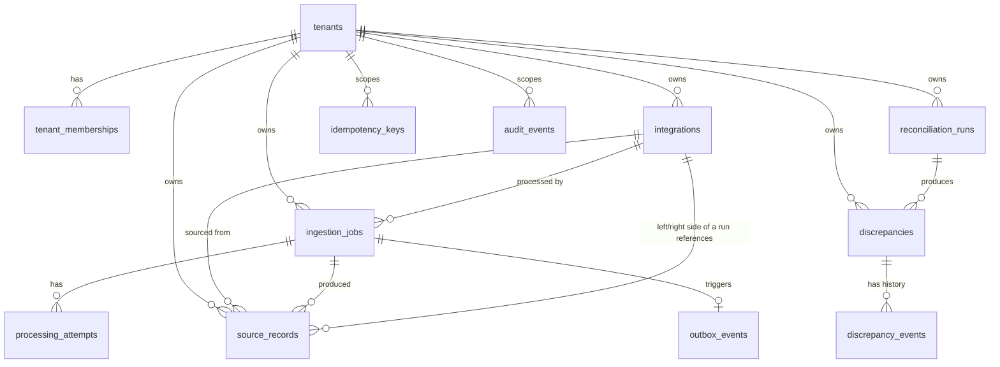

# Nexus — Data Model

Status: Phase 0 draft. Columns and indexes may be refined during
implementation, but the relationships and invariants listed here must be
preserved — they are the acceptance criteria for the Phase 2 migrations.

All tables live in PostgreSQL, managed exclusively through Flyway migrations
in `src/main/resources/db/migration`. No `ddl-auto` in any non-test profile.

## 1. Entity-relationship overview

## 2. Tables

### tenants

Customer organizations. The root of every authorization decision.

| Column | Type | Notes |
|---|---|---|
| `id` | `uuid` PK | |
| `name` | `text` NOT NULL | |
| `slug` | `text` NOT NULL UNIQUE | URL-safe identifier |
| `status` | `text` NOT NULL | `ACTIVE`, `SUSPENDED` — checked by worker before processing (see [architecture.md § 8](architecture.md#8-trust-boundaries)) |
| `created_at` | `timestamptz` NOT NULL DEFAULT now() | |

### tenant_memberships

User-to-tenant membership and role. **This table, not any request parameter,
is the source of truth for tenant access.**

| Column | Type | Notes |
|---|---|---|
| `id` | `uuid` PK | |
| `tenant_id` | `uuid` NOT NULL FK → `tenants.id` | |
| `principal_id` | `text` NOT NULL | subject claim from the OIDC token |
| `role` | `text` NOT NULL | `TENANT_ADMIN`, `OPERATOR`, `VIEWER` |
| `created_at` | `timestamptz` NOT NULL DEFAULT now() | |

**Constraints:** `UNIQUE (tenant_id, principal_id)` — one membership row per
principal per tenant.
**Index:** `(principal_id)` — this is the lookup used on every request to
resolve `TenantContext` for the authenticated principal; it must be fast.

### integrations

Configured external systems per tenant (e.g. "Acme CRM — production",
"Acme ERP — nightly export").

| Column | Type | Notes |
|---|---|---|
| `id` | `uuid` PK | |
| `tenant_id` | `uuid` NOT NULL FK → `tenants.id` | |
| `name` | `text` NOT NULL | |
| `source_system` | `text` NOT NULL | e.g. `CRM`, `ERP`, logical label used in reconciliation pairing |
| `connection_type` | `text` NOT NULL | `FILE_UPLOAD`, `REST_PULL` |
| `config` | `jsonb` NOT NULL | connection-type-specific config; never stores raw secrets (see [threat-model.md](threat-model.md)) |
| `status` | `text` NOT NULL DEFAULT `'ACTIVE'` | `ACTIVE`, `DISABLED` |
| `created_at` / `updated_at` | `timestamptz` NOT NULL | |

**Invariant:** an integration belongs to exactly one tenant (Invariant #1).
**Index:** `(tenant_id, status)`.

### ingestion_jobs

One row per import attempt's business unit of work — i.e. one logical import,
even across retries.

| Column | Type | Notes |
|---|---|---|
| `id` | `uuid` PK | |
| `tenant_id` | `uuid` NOT NULL FK → `tenants.id` | |
| `integration_id` | `uuid` NOT NULL FK → `integrations.id` | |
| `status` | `text` NOT NULL | `CREATED, QUEUED, PROCESSING, COMPLETED, COMPLETED_WITH_ERRORS, FAILED` |
| `idempotency_key` | `text` NOT NULL | client-supplied key, see `idempotency_keys` |
| `source_object_key` | `text` NULL | S3 key once upload is confirmed |
| `total_rows` | `int` NULL | |
| `valid_rows` | `int` NULL | |
| `error_rows` | `int` NULL | |
| `failure_reason` | `text` NULL | populated only when `status = FAILED` |
| `created_at` / `updated_at` | `timestamptz` NOT NULL | |
| `version` | `int` NOT NULL DEFAULT 0 | optimistic lock for concurrent status transitions |

**Invariant:** an ingestion job belongs to the tenant *and* integration it
processes; `integrations.tenant_id` must equal `ingestion_jobs.tenant_id`
(enforced by a composite FK via a covering unique index on
`integrations (id, tenant_id)`, or validated in application code with a DB
`CHECK`-equivalent trigger if the composite FK is impractical in Phase 2 —
documented as an assumption below).
**Constraint:** `UNIQUE (tenant_id, integration_id, idempotency_key)`.
**Index:** `(tenant_id, status, created_at)` for the job-listing/dashboard
query.

### source_records

Normalized business records with stable source identity. This is the table
every reconciliation run reads from.

| Column | Type | Notes |
|---|---|---|
| `id` | `uuid` PK | |
| `tenant_id` | `uuid` NOT NULL FK → `tenants.id` | |
| `integration_id` | `uuid` NOT NULL FK → `integrations.id` | |
| `ingestion_job_id` | `uuid` NOT NULL FK → `ingestion_jobs.id` | which import produced/last-touched this row |
| `source_system` | `text` NOT NULL | denormalized from `integrations.source_system` for fast comparison queries |
| `business_key` | `text` NOT NULL | the stable identifier reconciliation matches on (e.g. order number) |
| `payload` | `jsonb` NOT NULL | normalized record fields |
| `amount` | `numeric(18,2)` NULL | hoisted out of `payload` for indexed comparison |
| `record_timestamp` | `timestamptz` NULL | normalized to UTC; original offset kept in `payload` |
| `created_at` / `updated_at` | `timestamptz` NOT NULL | |

**Invariant:** stable source identity with an appropriate uniqueness
constraint (Invariant #3). **Constraint:**
`UNIQUE (tenant_id, integration_id, business_key)` is intentionally *not*
used here — duplicate business keys within a source are a valid, detectable
state (`DUPLICATE_BUSINESS_KEY` discrepancy), not a constraint violation. The
idempotency guarantee instead comes from
`UNIQUE (tenant_id, integration_id, source_system, external_record_id)` where
`external_record_id` is the row's identity *as assigned by the source system*
(e.g. CSV row's own ID column, or a hash of natural key + ingestion batch for
sources with no stable ID) — this is what makes re-processing the same row on
redelivery an idempotent upsert rather than a duplicate insert.
**Index:** `(tenant_id, integration_id, business_key)` (non-unique, for
reconciliation matching) and `(ingestion_job_id)`.

> **Assumption flagged for Phase 2:** the exact shape of
> `external_record_id` derivation (source-provided ID vs. computed hash) is
> source-type-dependent and will be finalized when the first two real
> `normalization` rule sets are implemented, not guessed now.

### reconciliation_runs

One row per reconciliation execution.

| Column | Type | Notes |
|---|---|---|
| `id` | `uuid` PK | |
| `tenant_id` | `uuid` NOT NULL FK → `tenants.id` | |
| `left_integration_id` | `uuid` NOT NULL FK → `integrations.id` | |
| `right_integration_id` | `uuid` NOT NULL FK → `integrations.id` | |
| `status` | `text` NOT NULL | `RUNNING, COMPLETED, FAILED` |
| `matched_count` / `discrepancy_count` | `int` NULL | populated on completion |
| `tolerance_config` | `jsonb` NOT NULL | amount tolerance, timestamp skew — snapshot at run time, so later config changes don't retroactively change the explanation of a past run |
| `started_at` / `completed_at` | `timestamptz` NULL | |
| `created_at` | `timestamptz` NOT NULL DEFAULT now() | |

**Constraint:** `CHECK (left_integration_id <> right_integration_id)`.
**Index:** `(tenant_id, status, created_at)`.

### discrepancies

| Column | Type | Notes |
|---|---|---|
| `id` | `uuid` PK | |
| `tenant_id` | `uuid` NOT NULL FK → `tenants.id` | |
| `reconciliation_run_id` | `uuid` NOT NULL FK → `reconciliation_runs.id` | |
| `business_key` | `text` NOT NULL | |
| `reason` | `text` NOT NULL | `AMOUNT_MISMATCH, MISSING_IN_LEFT, MISSING_IN_RIGHT, DUPLICATE_BUSINESS_KEY, TIMESTAMP_MISMATCH` |
| `explanation` | `jsonb` NOT NULL | field, left value, right value, tolerance applied — the explainability requirement |
| `status` | `text` NOT NULL DEFAULT `'OPEN'` | `OPEN, UNDER_REVIEW, RESOLVED, ACCEPTED_AS_EXPECTED` |
| `resolved_by` | `text` NULL | principal id |
| `resolved_at` | `timestamptz` NULL | |
| `version` | `int` NOT NULL DEFAULT 0 | optimistic lock — prevents double-resolution race (see [architecture.md § 10](architecture.md#10-failure-paths-and-recovery--summary)) |
| `created_at` | `timestamptz` NOT NULL DEFAULT now() | |

**Invariant:** a discrepancy belongs to a reconciliation run and tenant
(Invariant #4) — `tenant_id` is denormalized onto this row (rather than
joined through `reconciliation_runs`) specifically so that every
tenant-scoping query and RLS-style check can filter directly on
`discrepancies.tenant_id` without a join, which is also what makes the
"never trust a client tenantId" authorization check cheap to enforce
uniformly.
**Index:** `(tenant_id, status, created_at)` for the discrepancy dashboard;
`(reconciliation_run_id)`.

### discrepancy_events

Resolution and review history — append-only.

| Column | Type | Notes |
|---|---|---|
| `id` | `uuid` PK | |
| `discrepancy_id` | `uuid` NOT NULL FK → `discrepancies.id` | |
| `tenant_id` | `uuid` NOT NULL | denormalized, same reasoning as above |
| `event_type` | `text` NOT NULL | `OPENED, REVIEW_STARTED, RESOLVED, REOPENED, COMMENT_ADDED` |
| `actor_principal_id` | `text` NOT NULL | |
| `note` | `text` NULL | |
| `created_at` | `timestamptz` NOT NULL DEFAULT now() | |

No `updated_at` — rows are never updated, only inserted (Invariant #7:
resolution is auditable).

### idempotency_keys

Duplicate request protection, scoped per operation.

| Column | Type | Notes |
|---|---|---|
| `id` | `uuid` PK | |
| `tenant_id` | `uuid` NOT NULL | |
| `scope` | `text` NOT NULL | logical operation, e.g. `CREATE_INGESTION` |
| `key` | `text` NOT NULL | client-supplied `Idempotency-Key` header |
| `request_fingerprint` | `text` NOT NULL | hash of the normalized request body, to detect a key reused with a *different* payload |
| `response_status` | `int` NOT NULL | |
| `response_body` | `jsonb` NOT NULL | cached response, replayed verbatim on a repeat request |
| `created_at` | `timestamptz` NOT NULL DEFAULT now() | |

**Invariant:** an idempotency key cannot create duplicate effects within its
scope (Invariant #5). **Constraint:** `UNIQUE (tenant_id, scope, key)`. A
repeat request with the same key but a different `request_fingerprint`
returns `409 Conflict` (key reuse with different payload is a client bug, not
silently accepted) — see [api/initial-contract.md](api/initial-contract.md).
**Retention:** rows older than 24h are eligible for deletion by a scheduled
job — idempotency protection only needs to cover realistic client retry
windows, not forever.

### outbox_events

Events awaiting reliable publication to SQS.

| Column | Type | Notes |
|---|---|---|
| `id` | `uuid` PK | |
| `tenant_id` | `uuid` NOT NULL | |
| `aggregate_type` | `text` NOT NULL | e.g. `INGESTION_JOB` |
| `aggregate_id` | `uuid` NOT NULL | |
| `event_type` | `text` NOT NULL | e.g. `IngestionJobQueued` |
| `payload` | `jsonb` NOT NULL | |
| `created_at` | `timestamptz` NOT NULL DEFAULT now() | |
| `published_at` | `timestamptz` NULL | set by the Outbox Publisher after a successful `SendMessage` |
| `publish_attempts` | `int` NOT NULL DEFAULT 0 | |

**Invariant:** a committed business change and its outbox event are written
atomically (Invariant #6) — this row is inserted in the *same transaction* as
the business row update that caused it (see
[ADR-0003](adr/0003-transactional-outbox.md)).
**Index:** `(published_at) WHERE published_at IS NULL` — partial index, this
is the Outbox Publisher's poll query and must stay cheap as the table grows.
**Retention:** published rows older than 7 days are archived/deleted by a
scheduled job; they have no further use once delivered and are not the audit
trail (`audit_events` is).

### processing_attempts

Worker attempt history — one row per consume attempt, successful or not.

| Column | Type | Notes |
|---|---|---|
| `id` | `uuid` PK | |
| `ingestion_job_id` | `uuid` NOT NULL FK → `ingestion_jobs.id` | |
| `sqs_message_id` | `text` NOT NULL | |
| `attempt_number` | `int` NOT NULL | |
| `outcome` | `text` NOT NULL | `SUCCESS, TRANSIENT_FAILURE, PERMANENT_FAILURE` |
| `error_detail` | `text` NULL | |
| `started_at` / `finished_at` | `timestamptz` NOT NULL | |

**Index:** `(ingestion_job_id, attempt_number)`. This table is what makes a
redelivery observable rather than invisible (see
[architecture.md § 6](architecture.md#6-data-flow--workflow-c-recover-from-failures)).

### audit_events

Security-relevant and business-relevant audit trail. Append-only, and
written for *every* mutation that matters for compliance/forensics — not
just discrepancy resolution.

| Column | Type | Notes |
|---|---|---|
| `id` | `uuid` PK | |
| `tenant_id` | `uuid` NOT NULL | |
| `actor_principal_id` | `text` NOT NULL | |
| `action` | `text` NOT NULL | e.g. `DISCREPANCY_RESOLVED`, `INGESTION_RETRIED`, `INTEGRATION_CREATED` |
| `target_type` / `target_id` | `text` / `uuid` NOT NULL | |
| `metadata` | `jsonb` NOT NULL | action-specific details |
| `created_at` | `timestamptz` NOT NULL DEFAULT now() | |

**Invariant:** discrepancy resolution is auditable and authorized (Invariant
#7) — enforced by writing this row in the same transaction as the
`discrepancies` update, never as a best-effort side call.
**Retention:** audit events are retained indefinitely by default (no
scheduled deletion) — this is the one table in the system where "add a TTL"
is a decision that needs its own sign-off, not a default.
**Index:** `(tenant_id, created_at)`, `(target_type, target_id)`.

## 3. Tenant ownership summary

Every table above except `outbox_events`/`processing_attempts` (which are
infrastructure plumbing, still tenant-tagged for safe filtering) carries
`tenant_id` directly or via a mandatory, non-nullable FK chain no more than
one hop deep. This is deliberate: no tenant-scoped query should need more
than one join to filter by tenant, which keeps the "every query is tenant
scoped" rule in [CLAUDE.md](../CLAUDE.md) mechanically checkable.

## 4. Constraints that protect invariants even if application code is wrong

- `FOREIGN KEY` on every `tenant_id` reference — a row can't exist for a
  tenant that doesn't exist.
- `UNIQUE (tenant_id, integration_id, idempotency_key)` on `ingestion_jobs` —
  prevents a retried request from creating a second job even if application
  logic has a bug in its idempotency check.
- `UNIQUE (tenant_id, scope, key)` on `idempotency_keys`.
- `UNIQUE (tenant_id, integration_id, source_system, external_record_id)` on
  `source_records` — prevents a redelivered message from duplicating a
  record even if the worker's upsert logic has a bug.
- `CHECK (left_integration_id <> right_integration_id)` on
  `reconciliation_runs` — a run can't reconcile an integration against
  itself.
- `NOT NULL` on every FK and every status/enum-like column — no row can exist
  in an ambiguous "unset" state.

## 5. Indexing principles

- Every tenant-scoped table gets a composite index leading with `tenant_id`
  matching its dominant query (dashboard list, status filter) — a tenant with
  10,000 rows must not degrade another tenant's query.
- Partial indexes (`WHERE published_at IS NULL`, `WHERE status = 'OPEN'`) for
  queues/worklists that are read far more often in their "pending" state than
  in aggregate.
- No index is added speculatively in Phase 2 migrations; new indexes are
  added when a Phase 4 load test shows a specific slow query, with the
  `EXPLAIN ANALYZE` evidence recorded in the PR.

## 6. Retention considerations

| Table | Retention stance | Reason |
|---|---|---|
| `idempotency_keys` | 24h | Only needs to cover realistic retry windows |
| `outbox_events` | 7 days after publish | No value once delivered; not the audit trail |
| `processing_attempts` | 90 days | Operational debugging window, not permanent record |
| `source_records` | Indefinite (tenant-deletable) | Business data; deleted only on tenant offboarding |
| `discrepancies` / `discrepancy_events` | Indefinite | Audit-relevant business outcome |
| `audit_events` | Indefinite, deletion requires explicit sign-off | Compliance/forensic record |

Retention is enforced by scheduled jobs reading `created_at`/`published_at`,
not by Postgres native partition expiry in v1 — partitioning by time is a
candidate optimization if `outbox_events` or `processing_attempts` volume
makes DELETE-based cleanup too slow, deferred until there's a measured reason
(see [build-plan.md](build-plan.md) Phase 6).
